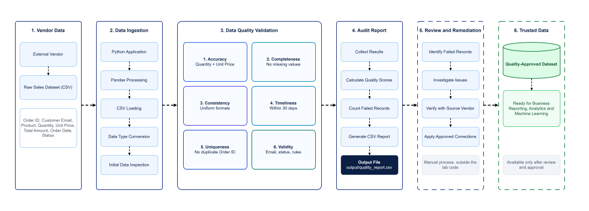
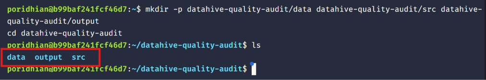
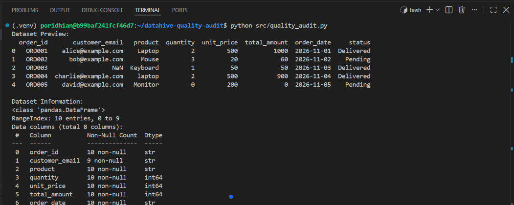
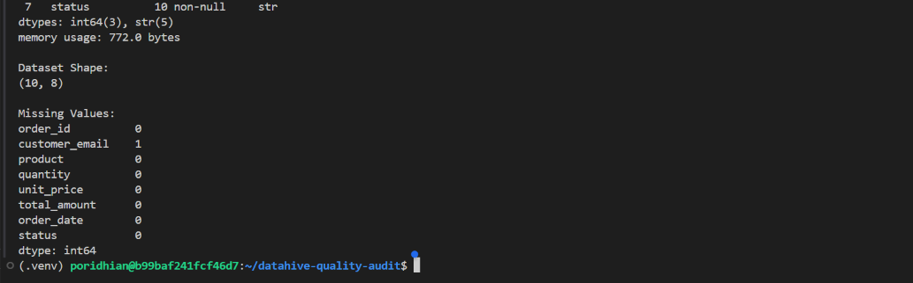
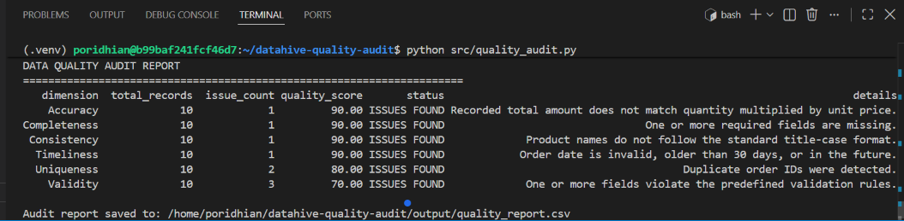
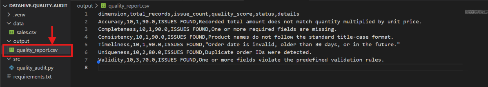

# Building Reliable Data Pipelines with Data Quality Validation

## Introduction

DataHive receives sales records from different vendors and combines them for business reporting. Some records arrive with missing fields, duplicate order IDs, inconsistent product names, outdated dates, or incorrect values. These issues can lead to unreliable reports if they are not detected before analysis. In this lab, the DataHive team will build a Python-based audit system to evaluate a sample sales dataset using six fundamental data quality dimensions.


## Project File Structure

```text
datahive-quality-audit/
├── data/
│   └── sales.csv
├── src/
│   └── quality_audit.py
├── output/
│   └── quality_report.csv
└── requirements.txt
```

## Learning Objectives

By the end of this lab, students will be able to:

- Explain the six fundamental dimensions of data quality.
- Load and inspect a CSV dataset using Pandas.
- Implement rule-based checks for common data quality issues.
- Calculate a quality score for each dimension.
- Generate and interpret a CSV audit report.

# Project Implementation

## Chapter 1 — Set Up the Project Environment

Open VS Code Server or your preferred terminal.

Create the project directories:

```bash
mkdir -p datahive-quality-audit/data datahive-quality-audit/src datahive-quality-audit/output
cd datahive-quality-audit
```


Create and activate a virtual environment:

**On Linux / macOS / VS Code Server:**

```bash
python3 -m venv .venv
source .venv/bin/activate
```

**On Windows (PowerShell):**

```powershell
python -m venv .venv
.\.venv\Scripts\Activate.ps1
```

Create `requirements.txt` in the project root and add:

```text
pandas>=2.0.0
```

Install the dependency:

```bash
pip install -r requirements.txt
```

The virtual environment isolates the Python packages required by this lab. Pandas will be used to load, inspect, and audit the vendor dataset. The project directories separate input data, source code, and generated reports.

## Chapter 2 — Understand the Six Data Quality Dimensions

DataHive will evaluate the vendor dataset using six dimensions.

| Dimension | Meaning | Example |
|---|---|---|
| Accuracy | Values correctly represent real-world information. | `quantity × unit_price` matches `total_amount`. |
| Completeness | Required fields contain values. | An order has a customer email. |
| Consistency | Values follow a common representation and business rule. | Product names use a consistent format. |
| Timeliness | Data is current enough for its intended use. | An order date is within the accepted time window. |
| Uniqueness | Records that should be unique are not duplicated. | Each order has a unique order ID. |
| Validity | Values follow expected formats, types, and allowed ranges. | Email format is valid and quantity is positive. |

A dataset can pass one dimension and fail another. For example, a record may contain every required field but still have an incorrect sales amount. The six dimensions therefore check different aspects of quality and should be evaluated separately.

## Chapter 3 — Prepare the Sample Sales Dataset

Inside the `datahive-quality-audit` project, open the `data` directory and create a file named `sales.csv`.

Add the following sample records:

```csv
order_id,customer_email,product,quantity,unit_price,total_amount,order_date,status
ORD001,alice@example.com,Laptop,2,500,1000,2026-11-01,Delivered
ORD002,bob@example.com,Mouse,3,20,60,2026-11-02,Pending
ORD003,,Keyboard,1,50,50,2026-11-03,Delivered
ORD004,charlie@example.com,laptop,2,500,900,2026-11-04,Delivered
ORD005,david@example.com,Monitor,0,200,0,2026-11-05,Pending
ORD006,invalid-email,Mouse,2,20,40,2026-11-06,Shipped
ORD006,emma@example.com,Keyboard,1,50,50,2026-11-06,Delivered
ORD008,frank@example.com,Tablet,1,300,300,2026-10-01,Delivered
ORD009,grace@example.com,Monitor,2,200,400,2026-11-08,Unknown
ORD010,henry@example.com,Mouse,2,20,40,2026-11-09,Pending
```

The sample contains ten records designed for auditing. It includes a missing email (`ORD003`), a sales calculation mismatch (`ORD004`), inconsistent product capitalization (`ORD004`), a zero quantity (`ORD005`), an invalid email (`ORD006`), a duplicate order ID (`ORD006`), an outdated order date (`ORD008`), and an unrecognized status (`ORD009`). 

*(Note: `ORD007` is skipped in the ID sequence due to vendor ingestion deduplication artifacts, keeping the dataset at exactly 10 records).*

## Chapter 4 — Load and Inspect the Dataset

Create `quality_audit.py` inside the `src` directory to perform initial exploration of the incoming records:

```python
from pathlib import Path
import pandas as pd

BASE_DIR = Path(__file__).resolve().parent.parent
DATA_FILE = BASE_DIR / "data" / "sales.csv"
OUTPUT_DIR = BASE_DIR / "output"

OUTPUT_DIR.mkdir(exist_ok=True)

# Load the vendor dataset
df = pd.read_csv(DATA_FILE)

# Inspect the dataset
print("Dataset Preview:")
print(df.head())

print("\nDataset Information:")
df.info()

print("\nDataset Shape:")
print(df.shape)

print("\nMissing Values:")
print(df.isnull().sum())
```

Run the script from the project root:

```bash
python src/quality_audit.py
```



`pd.read_csv()` loads the CSV file into a Pandas DataFrame. The preview, structure, shape, and missing-value summary provide an initial view of the incoming records. This inspection helps confirm that the file is readable and that the expected columns are available before the quality checks run.

## Chapter 5 — Implement the Six Quality Checks

Now, update `src/quality_audit.py` with the complete, production-ready quality audit system.

```python
from pathlib import Path
import pandas as pd

BASE_DIR = Path(__file__).resolve().parent.parent
DATA_FILE = BASE_DIR / "data" / "sales.csv"
OUTPUT_DIR = BASE_DIR / "output"

OUTPUT_DIR.mkdir(exist_ok=True)

# Load the dataset
df = pd.read_csv(DATA_FILE)

# Convert numeric columns safely
for column in ["quantity", "unit_price", "total_amount"]:
    df[column] = pd.to_numeric(df[column], errors="coerce")

# Parse dates
order_dates = pd.to_datetime(df["order_date"], errors="coerce")

audit_results = []
total_records = len(df)


def add_result(dimension, issues, details):
    issue_count = int(issues.fillna(True).sum()) if hasattr(
        issues, "fillna"
    ) else int(issues.sum())

    score = (
        (total_records - issue_count) / total_records * 100
        if total_records > 0
        else 100
    )

    audit_results.append({
        "dimension": dimension,
        "total_records": total_records,
        "issue_count": issue_count,
        "quality_score": round(score, 2),
        "status": "PASS" if issue_count == 0 else "ISSUES FOUND",
        "details": details
    })


# 1. ACCURACY
expected_amount = df["quantity"] * df["unit_price"]

accuracy_issues = (
    (df["total_amount"] - expected_amount).abs() > 0.01
) | expected_amount.isna() | df["total_amount"].isna()

add_result(
    "Accuracy",
    accuracy_issues,
    "Recorded total amount does not match quantity multiplied by unit price."
)


# 2. COMPLETENESS
required_columns = [
    "order_id",
    "customer_email",
    "product",
    "quantity",
    "unit_price",
    "total_amount",
    "order_date",
    "status"
]

completeness_issues = df[required_columns].isna().any(axis=1)

add_result(
    "Completeness",
    completeness_issues,
    "One or more required fields are missing."
)


# 3. CONSISTENCY
normalized_product = df["product"].astype("string").str.strip().str.title()

consistency_issues = (
    df["product"].notna()
    & (df["product"] != normalized_product)
)

add_result(
    "Consistency",
    consistency_issues,
    "Product names do not follow the standard title-case format."
)


# 4. TIMELINESS
# Define an audit reference date for deterministic testing.
# In a live production pipeline, replace audit_date with: pd.Timestamp.today().normalize()
audit_date = pd.Timestamp("2026-11-12")
oldest_allowed_date = audit_date - pd.Timedelta(days=30)

timeliness_issues = (
    order_dates.isna()
    | (order_dates < oldest_allowed_date)
    | (order_dates > audit_date)
)

add_result(
    "Timeliness",
    timeliness_issues,
    "Order date is invalid, older than 30 days, or in the future."
)


# 5. UNIQUENESS
uniqueness_issues = df["order_id"].duplicated(keep=False)

add_result(
    "Uniqueness",
    uniqueness_issues,
    "Duplicate order IDs were detected."
)


# 6. VALIDITY
# Evaluate format and domain rules only on non-missing values
# so that missing values are not double-counted as invalid formats.
email_valid = df["customer_email"].isna() | df["customer_email"].astype("string").str.fullmatch(
    r"[^@\s]+@[^@\s]+\.[^@\s]+",
    na=False
)

status_valid = df["status"].isna() | df["status"].isin(
    ["Pending", "Shipped", "Delivered"]
)

quantity_valid = df["quantity"].isna() | (df["quantity"] > 0)
price_valid = df["unit_price"].isna() | (df["unit_price"] >= 0)
amount_valid = df["total_amount"].isna() | (df["total_amount"] >= 0)
date_format_valid = df["order_date"].isna() | order_dates.notna()

validity_issues = ~(
    email_valid
    & status_valid
    & quantity_valid
    & price_valid
    & amount_valid
    & date_format_valid
)

add_result(
    "Validity",
    validity_issues,
    "One or more fields violate the predefined validation rules."
)


# Generate the audit report
report = pd.DataFrame(audit_results)

output_file = OUTPUT_DIR / "quality_report.csv"
report.to_csv(output_file, index=False)

print("\nDATA QUALITY AUDIT REPORT")
print("=" * 70)
print(report.to_string(index=False, formatters={"quality_score": "{:.2f}".format}))

print(f"\nAudit report saved to: {output_file}")
```

The script evaluates the dataset independently against all six dimensions. The `add_result()` function records the number of affected rows and calculates a score for each check. The checks use explicit business rules, such as matching sales calculations, requiring populated fields, enforcing standard product capitalization, filtering duplicate identifiers, validating reference date ranges, and enforcing field domain rules.

Crucially, Validity rules allow missing values to be handled strictly by Completeness, ensuring each dimension isolates its specific concern without cross-contamination.

## Chapter 6 — Execute the Data Quality Audit

From the project root, execute:

```bash
python src/quality_audit.py
```

Expected terminal output for the sample dataset:




The output shows the number of records that failed each dimension's check:
- **Accuracy (90.00%)**: 1 issue (`ORD004`: total calculated as $900 instead of $1000).
- **Completeness (90.00%)**: 1 issue (`ORD003`: missing email).
- **Consistency (90.00%)**: 1 issue (`ORD004`: product name in lowercase `laptop`).
- **Timeliness (90.00%)**: 1 issue (`ORD008`: date `2026-10-01` is older than the 30-day window).
- **Uniqueness (80.00%)**: 2 issues (`ORD006` appears twice; `keep=False` flags both rows).
- **Validity (70.00%)**: 3 issues (`ORD005`: quantity is 0; `ORD006`: `invalid-email`; `ORD009`: status `Unknown`).

## Chapter 7 — Examine the Generated Audit Report

Open the `output` directory and view `quality_report.csv`.



The report contains the following columns:

| Column | Description |
|---|---|
| `dimension` | Name of the quality dimension. |
| `total_records` | Total number of records evaluated. |
| `issue_count` | Number of records flagged by the check. |
| `quality_score` | Percentage of records passing the check (0.00 to 100.00). |
| `status` | `PASS` if issue count is 0, otherwise `ISSUES FOUND`. |
| `details` | Explanation of the validation rule and business expectation. |

The CSV report provides a persistent summary of the audit results. It can be opened in a spreadsheet application, consumed by an automated CI/CD pipeline, or logged into a centralized data observability platform.

## Chapter 8 — Review the Data Quality Findings

Use the audit results to identify the records that require investigation:

| Dimension | Sample finding | Affected record | Explanation |
|---|---|---|---|
| Accuracy | Incorrect calculated total | ORD004 | Quantity (2) × Unit Price (500) = 1000, but total is 900. |
| Completeness | Missing customer email | ORD003 | Mandatory contact email field is null. |
| Consistency | Inconsistent product capitalization | ORD004 | Product recorded as `laptop` instead of title-case `Laptop`. |
| Timeliness | Order date outside the 30-day window | ORD008 | Order date `2026-10-01` exceeds the 30-day freshness threshold. |
| Uniqueness | Repeated order ID | Both ORD006 records | The same order identifier was ingested twice. |
| Validity | Invalid email, zero quantity, or unknown status | ORD005, ORD006, ORD009 | Non-positive quantity (0), malformed email syntax, and unregistered status value. |

The findings isolate individual records for targeted remediation. A failed check does not necessarily mean a record should be deleted; the team should reconcile with the source vendor or transaction database before altering production data.

# Conclusion

In this lab, the DataHive team built a Python-based data quality auditing system using Pandas. Students explored the six fundamental dimensions of data quality: accuracy, completeness, consistency, timeliness, uniqueness, and validity. They implemented validation rules to detect common problems in a vendor sales dataset and generated a CSV report containing issue counts and quality scores. This auditing approach can be reused to evaluate incoming datasets before they are used for business reporting and further data processing.

# Check Your Understanding

1. What are the six fundamental dimensions of data quality, and what does each one measure?
2. Can a dataset be complete but inaccurate? Explain with an example.
3. Why does `duplicated(keep=False)` flag both records involved in a duplicate instead of only the later occurrence?
4. What is the difference between accuracy and validity?
5. Why should a team investigate flagged records before modifying or deleting them?
